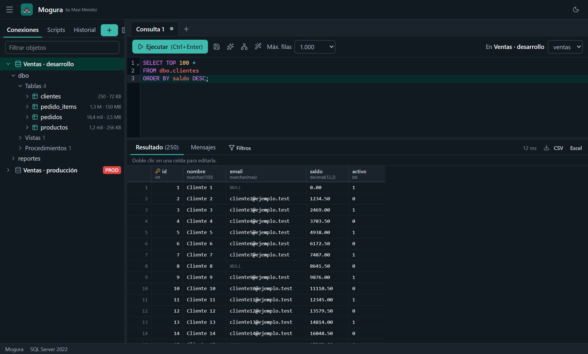
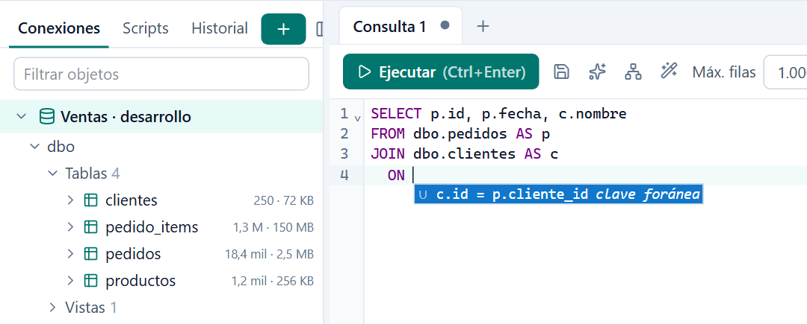
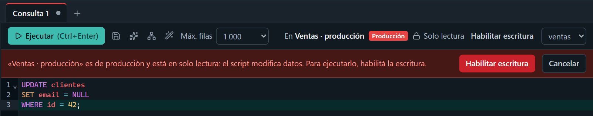
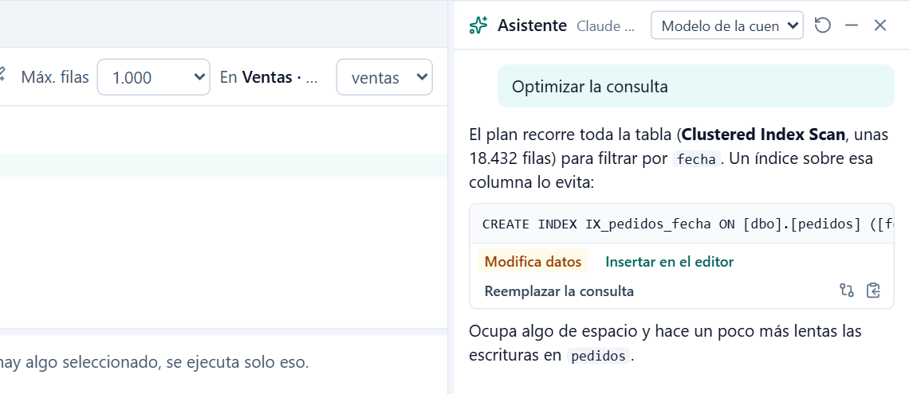
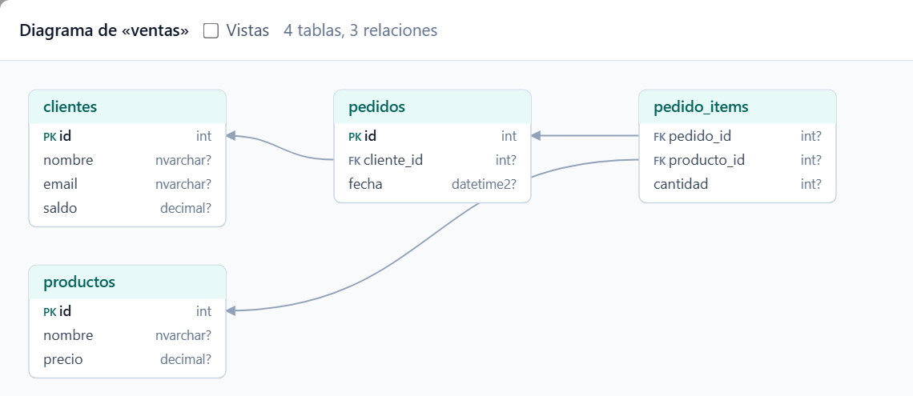
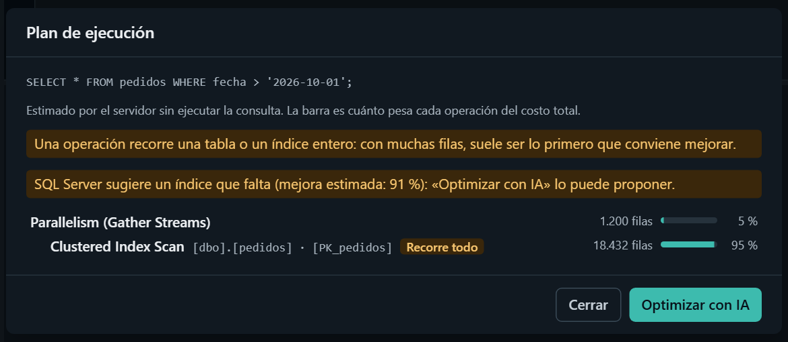

# Mogura

**by Maxi Mendez**

Administrador de bases de datos para Windows: liviano, rápido y en español. 
SQL Server y Azure SQL, PostgreSQL, MySQL y SQLite, en una sola app.

### [⬇&nbsp; Descargar Mogura](https://github.com/maxicuyo94/mogura-releases/releases/latest)

 

 

## Por qué Mogura

<table>
<tr>
<td width="25%" valign="top">

### ⚡ Liviana
El instalador pesa unos 7 MB y la app abre al instante, sin Java ni nada extra.

</td>
<td width="25%" valign="top">

### 🔒 Segura con producción
Las conexiones de producción arrancan en solo lectura. Para escribir, Windows Hello y confirmación.

</td>
<td width="25%" valign="top">

### ☁️ Lista para Azure
Entra con tu cuenta de Microsoft (Entra ID) a Azure SQL y renueva la sesión sola.

</td>
<td width="25%" valign="top">

### ✨ IA que no se manda sola
Explica, arregla y optimiza, pero lo que propone pasa al editor con un botón: nunca se ejecuta solo.

</td>
</tr>
</table>

 

## Así se ve

<table>
<tr>
<td width="45%" valign="middle">

### Autocompletado que conoce tu base
Sugiere tablas, columnas y alias del esquema real. Al escribir un `JOIN … ON`, propone la condición por clave foránea.

</td>
<td width="55%"></td>
</tr>
<tr>
<td width="55%"></td>
<td width="45%" valign="middle">

### Producción, sin sustos
Un script que modifica datos en producción no se ejecuta hasta que habilitás la escritura con Windows Hello y confirmás. Un `UPDATE` o `DELETE` sin `WHERE` siempre pide confirmación, en cualquier conexión.

</td>
</tr>
<tr>
<td width="45%" valign="middle">

### Un asistente que propone, no ejecuta
Con Ctrl+K le preguntás a la IA, o le pedís que explique, arregle un error u optimice a partir del plan de ejecución. Solo recibe el esquema que hace falta, nunca tus filas.

</td>
<td width="55%"></td>
</tr>
<tr>
<td width="55%"></td>
<td width="45%" valign="middle">

### El esquema, de un vistazo
El diagrama arma las tablas y sus relaciones a partir de las claves foráneas. Las podés acomodar y guardar como SVG.

</td>
</tr>
<tr>
<td width="45%" valign="middle">

### El plan de ejecución, dibujado
Mirá cómo va a resolver la base tu consulta sin ejecutarla: cada operación con sus filas estimadas y cuánto pesa del total. Los recorridos de tablas enteras y los índices que faltan quedan marcados.

</td>
<td width="55%"></td>
</tr>
</table>

 

## Todo lo que trae

<table>
<tr>
<td width="50%" valign="top">

**Escribir y ejecutar**
- Pestañas que se recuerdan al cerrar
- Formatear SQL con Shift+Alt+F
- Variables `${nombre}` con valores por defecto, listas y fechas
- Historial cifrado y scripts guardados
- Cancelar consultas largas; las filas llegan de a páginas

**Resultados**
- Ordenar y filtrar sin volver a consultar
- Editar celdas, con validación y en una transacción
- Exportar a CSV o Excel, o copiar como `INSERT`

</td>
<td width="50%" valign="top">

**La base**
- Árbol con tablas, vistas, rutinas, índices y triggers, y el tamaño de cada tabla
- Dump de estructura y datos, con avance y cancelación
- Importar CSV o Excel a una tabla
- Abrir un CSV o Excel y editarlo como planilla
- Comparar esquemas entre dos bases, con el script de diferencias

**Para todos los días**
- Modo claro y oscuro
- Toda la app en español
- Se actualiza sola

</td>
</tr>
</table>

 

## Instalar

1. Bajá `Mogura_X.Y.Z_x64-setup.exe` de la [última versión](https://github.com/maxicuyo94/mogura-releases/releases/latest).
2. Ejecutalo. No hace falta ser administrador.

Funciona en Windows 10 y 11 de 64 bits. Para el asistente de IA hace falta tener instalado [Claude Code](https://claude.com/claude-code), con tu cuenta de Claude.

 

Hecho por Maxi Mendez. Este repo guarda las versiones publicadas: las apps instaladas consultan acá si hay una nueva.

